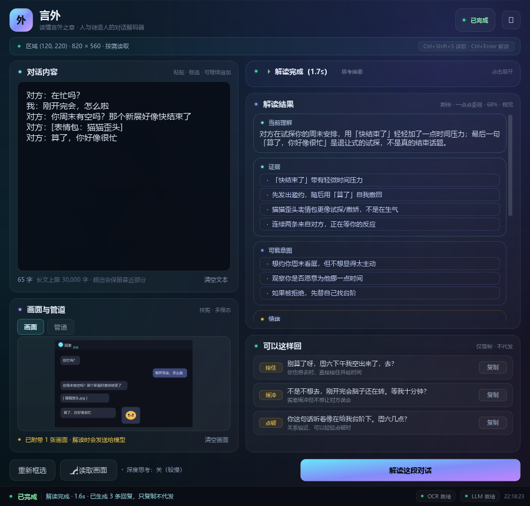
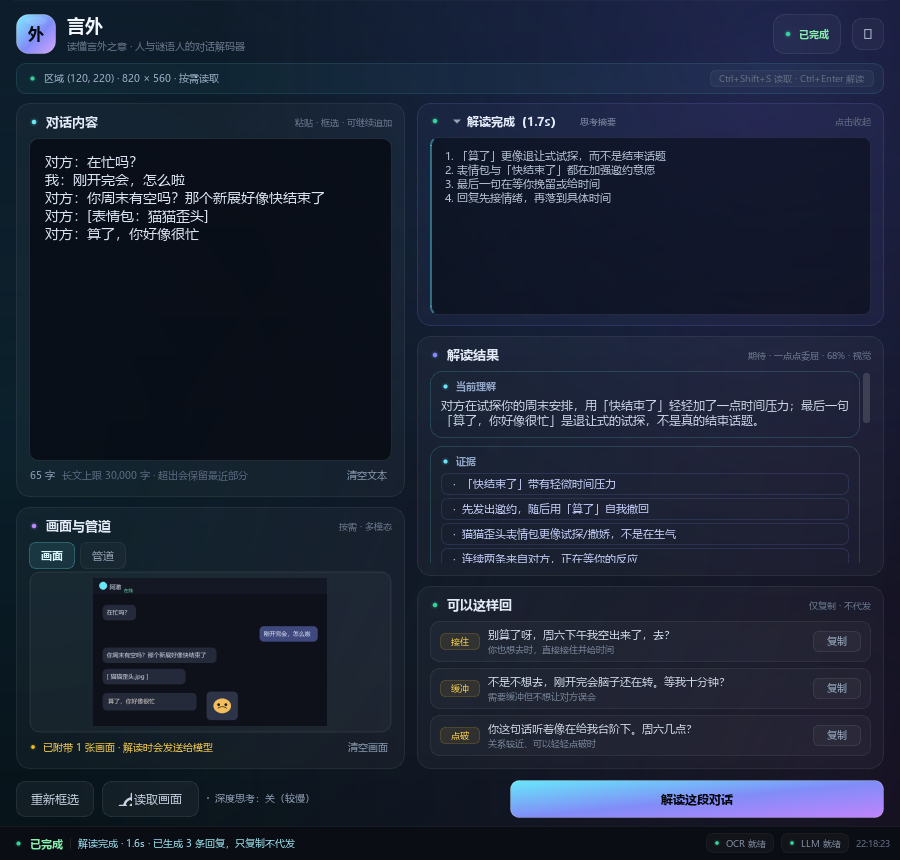

# 言外 · Yanwai

> 把谜语人的话，翻译成人话。

**言外** 是一个 Windows 桌面端的**按需对话解码器**。粘贴记录或框选聊天窗口后，它会整理发言者和消息，结合长文上下文、表情包和截图，总结整段聊天，识别最近事件并给出几条回复建议。

> 内部目录/配置名仍保留 `OCRChatAssistant`，用于兼容已有 API Key 与设置；产品显示名已改为「言外」。





> 截图使用合成演示数据，不包含真实聊天内容。

## 为什么是「言外」

- **对方是谜语人**：说「算了」「你好像很忙」「随便你」，字面意思和真实意思经常不是一回事。
- **聊天太长**：真实关系不只藏在最后一屏，前文的关系、话题线和情绪转折同样重要。
- **表情包不会 OCR**：猫猫歪头、狗头、沉默、表情包，OCR 读不出来，但视觉模型能看见。

言外不是「读心术」。每个结论都会附证据、替代解释和不确定性；判断权始终在你手里。

## 核心能力

### 1. 按需读取，不持续监控

- 点击「读取画面」时，读取所选窗口的聊天区域一次。滚动采集由「开始采集」显式启动。
- 也支持直接把完整聊天记录粘贴到左侧编辑器。
- 阅读长聊天时向上滚动，再点一次「读取画面」即可**追加**文本和截图；最多保留 4 张画面。

### 2. 一次框选，滚动采集整段聊天

- 点 **开始采集**，选择聊天窗口，框选左侧会话列表和右侧标题、聊天区。在「画面」页可实时看见同一选区，滚动时预览随之更新。
- OCR 独立按默认 0.7 秒间隔采样变化画面。结束采集时立即关掉预览，随后整理已入队的记录。
- 支持识别 QQ 式双栏布局。左栏用于定位当前会话，右栏消息进入记录。由群聊标记、标题人数和发言者判断群聊或私聊，已有会话名称且类型证据不足时显示「类型待确认」。
- 优先按头像和附近昵称给消息标注发言者。昵称不清楚时保留参与者或方向标签。检测到切换会话时保留原会话并结束本轮采集。
- 只对「画面确实变了」的关键帧做识别，滚动停下时不会重复识别同一屏。
- 拼接以**行序列**为单位：相邻多行的文本相似度 + OCR 坐标（行距、左右对齐）共同判断重叠，能容忍少量识别错字；聊天里真实重复的「好的」会全部保留，不会被当成重复行删掉。
- 没有可靠重叠时**标断点**而不是编造内容，可以滚回去补采那一段。
- 结束采集会先把已入队的画面识别完再输出，避免结尾丢字；画面队列满了会提示放慢滚动，并在结果里标出断点。
- Windows 窗口采集跟随所选窗口，其他窗口盖在上面时也不会进入画面。窗口尺寸或缩放变化后，请结束并重新框选；窗口关闭时自动收尾。
- 预览里可以额外框选固定的联系人或群名，标题区域变化时暂停。需要兼容桌面截图时，选择「改用屏幕框选」。
- 结果写进左侧编辑器（`Ctrl+Z` 可以撤销这次替换），可继续编辑、**复制全文**、**导出 UTF-8 TXT**，也可以直接点「解读这段对话」。

### 3. 长文理解

- 单次上下文预算默认为 **30,000 字**，可在设置中调整。超出时分段归纳较早的历史，结合最近原文和历史摘要完成最终解读。
- 「长篇对话总结」展示全局脉络、关键进展、已确定事项和待确认问题。
- 「最近一件事」展示当前进展、参与者和可定位的原文证据。回复优先回应这件事仍待处理的问题。

### 4. 多模态 / 表情包理解

- 视觉理解**默认开启**：读取画面时会把截图压缩成 JPEG（默认最大边 1024、画质 80%）随本次解读发送。
- 支持一次附带多张截图（默认最多 4 张）。
- Prompt 明确要求：表情包、贴纸、emoji、图片必须解释其情绪与潜台词，不能当装饰跳过。
- 关闭视觉后，画面只在本地预览，不发送任何图片。

> 视觉能力依赖模型支持图片输入。当前配置的 `qwen3.7-plus` 已实测支持。

### 5. 快速 / 深度两种模式

- **默认快速**：不展开长篇隐藏推理，要求 3–5 条简短步骤 + 结论。本机真实模型实测约 **25s**。
- **深度思考（可选）**：使用推理模型的流式思考，通常 **30–60s**；完成后自动折叠，也可以手动展开。
- 两种模式都会输出思考摘要、证据、替代解释、3 条回复建议；深度模式只是更慢、更深。

### 6. 更精准的结构化输出

- Pydantic v2 Schema 校验；JSON 解析失败自动修复重试一次。
- 字段包括：`thinking`、`surface_meaning`、`possible_intent`、`emotion`（含置信度与证据）、`potential_needs`、`evidence`、`alternatives`、`reply_strategy`、`suggested_replies`（每条含 `why`）、`uncertainty`。
- 回复建议只复制到剪贴板，**不会自动粘贴或发送任何消息**。

## Windows 安装包

已构建为 Windows 安装程序（按用户安装，无需管理员权限，不写入系统目录）：

- 下载：<https://github.com/fy664/ocr-chat-assistant/releases>
- 本地构建方式见 [Windows 打包说明](packaging/README.md)。安装程序使用带版本号的文件名。
- 安装包**不包含** `.env`、`config.json`、API Key、日志或任何用户数据；首次启动后在「设置 → LLM」中配置自己的接口。
- 安装程序未做代码签名，Windows SmartScreen 可能提示“未知发布者”；选择“仍要运行”即可。
- 首次读取画面时会下载 PaddleOCR 模型（约 100MB），需要网络；之后离线可用本地 OCR。
## 快速开始

### 环境

- Windows 10 / 11
- Python 3.11 或 3.12
- 首次读取画面需要下载 PaddleOCR 模型（约 100MB）
- 可访问你配置的 OpenAI-compatible LLM 接口

### 安装与运行

```powershell
.\setup.ps1
.\run.ps1                     # 正常模式
.\run.ps1 --mock-llm          # 无需 API Key，体验界面与思考摘要
.\run.ps1 --debug             # 调试日志
```

### 使用

1. **粘贴**：把完整聊天记录放进左侧「对话内容」，建议保留「对方：」「我：」这样的说话人标签；
   或点击 **读取画面**（`Ctrl+Shift+S`），选中窗口并在预览里框选左侧列表、右侧标题和消息区。OCR 结果会追加到当前会话的编辑记录。
2. **整段聊天太长**：点 **开始采集**，沿用选区或在窗口预览里重新框选，然后缓慢上下滚动。
   采集条会显示已拼出的行数、断点和队列情况。滚完点 **结束采集**，等收尾识别完成，结果自动进入编辑器。
   若出现了断点，滚回那段重新采一遍即可；结果可 **复制全文** / **导出 TXT**。
3. 只想补一屏：向上滚动记录，再点一次「读取画面」，文本与画面会继续追加（自动去掉重叠行）。
4. 点击 **解读这段对话**（`Ctrl+Enter`），或勾选 **采集后自动解读**，让读取或采集结束后直接提交给配置的模型。
5. 右侧查看整段总结、最近一件事、语义解读和回复建议。回复可一键复制。
6. 清空文本或画面不会影响已保存的 API 设置。

## 设置

**「设置 → LLM」** 可配置 Base URL、模型、API Key、温度和请求超时。界面保存密钥时使用 Windows 凭据管理器。开发环境可手动提供 `.env`。进程环境变量优先于界面设置，`.env` 为开发环境提供缺省值。

**「设置 → 采集」** 可调整滚动 OCR 采样间隔（默认 700 ms）和等待队列（默认 6 帧）。实时画面按独立频率更新。

**「设置 → 解读」**：

| 选项 | 默认 | 说明 |
|---|---|---|
| 多模态视觉 | 开启 | 读取画面时附带截图；可关闭，关闭后画面仅本地预览 |
| 深度思考 | 关闭 | 使用推理模型流式思考，较慢；关闭时仍输出简短思考摘要 |
| 自动折叠 | 开启 | 深度思考/摘要完成后折叠，点击标题展开 |
| 单次上下文 | 30,000 字 | 超出预算时，先分段归纳历史，再解读最近原文 |
| 画面张数 | 4 张 | 一次解读最多附带的截图数量 |
| 输出上限 | 2,600 tokens | 快速模式输出上限；深度模式自动放宽 |

**「设置 → 界面」**：窗口置顶、窗口行为等。

## 隐私边界

- **不持续监控**：没有定时截图、没有后台循环、没有逐帧 OCR（连续采集只在你点了「开始采集」之后运行，点「结束采集」即停）。
- **采集全程本地**。选区、头像特征、PaddleOCR 和滚动拼接都在本机处理。
- **解读阶段使用配置的模型**。可手动点击解读，也可主动启用「采集后自动解读」。
- **截图仅在内存中处理**。开启视觉时，识别到的消息区会压缩成 JPEG 随解读请求发送。
- **滚动采集最多附带一张画面**。程序保留原会话最后一张成功识别的画面。
- **OCR 全本地**：PaddleOCR 在你的机器上完成识别。
- **API Key**：Windows 凭据管理器；不硬编码、不进 Git、不写日志。
- **日志**：`%APPDATA%\OCRChatAssistant\logs\`，不含 Key 与完整聊天内容。
- **回复**：只复制到剪贴板，程序不会自动粘贴或发送。

> 视觉默认开启，是因为表情包/贴纸理解是言外的核心场景；如果你不希望发送图片，可在「设置 → 解读」中关闭。关闭后不会发送任何截图。

## 性能与内存

- 没有常驻采样循环：不读取时几乎不产生 OCR/网络开销。
- OCR 模型**懒加载**：不读取画面就不会初始化 PaddleOCR。
- 帧队列和截图数量均有上限，滚动采集结束后回收暂存帧。
- 长文按消息分段归纳，同一会话的模型请求按顺序执行。
- 默认快速模式限制了输出上限；深度思考才放宽到更高 token。
- 连续采集的识别队列有界（默认 6 帧，最多 16）：队列满时丢弃**最新**帧并提示放慢滚动，不会静默覆盖旧帧导致乱序。

## 技术结构

查看 [项目骨架与数据流](docs/ARCHITECTURE.md)。

```
app/
├─ main.py                    # 入口：言外 · 对话解码器
├─ config/settings.py         # 设置 + 迁移 + 钳制
├─ models/schemas.py          # Pydantic 数据模型
├─ capture/
│  ├─ window_capture.py       # Qt 窗口捕获、窗口相对选区与标题保护
│  ├─ screen_capture.py       # mss 屏幕框选兼容入口
│  ├─ frame_gate.py           # 帧门控（旧版实时引擎 + 采集时做重复画面检测）
│  ├─ scroll_signal.py        # 行投影互相关，估计滚动方向与位移
│  ├─ window_guard.py         # 前台窗口 / 选区有效性检查（用于自动暂停）
│  └─ region_selector.py      # 框选 overlay
├─ ocr/                       # PaddleOCR 适配、预处理、行结构
├─ analysis/
│  ├─ decoder.py              # v2 按需解码控制器（本产品使用）
│  ├─ capture_session.py      # 连续采集会话（采样 → 方向估计 → 暂停守卫）
│  ├─ chat_layout.py           # 双栏、会话类型、头像与发言者识别
│  ├─ stitch.py               # 滚动截图拼接：行序列、坐标、发言者、断点
│  ├─ workers.py              # 有界 OCR 队列及旧版分析 worker
│  ├─ analyzer.py             # 旧的单次分析入口
│  └─ scheduler.py            # 旧版实时引擎（legacy，不再由 app 启动）
├─ agent/                     # 历史归纳、最近事件、证据回填、后台编排
├─ llm/
│  ├─ provider.py             # OpenAI-compatible：流式 / 图片 / token 上限
│  ├─ prompt.py               # 长文 + 表情包 + 谜语人 Prompt
│  ├─ vision.py               # 截图 → JPEG data URL
│  └─ parser.py               # JSON 提取 + 校验
└─ ui/
   ├─ decoder_window.py       # v2 主窗口（按需解读）
   ├─ window_picker.py        # 选择窗口和预览框选
   ├─ panels.py               # 思考面板 / 阶段指示器 / 日志 / 画面预览
   ├─ floating_panel.py       # 分析卡片 + 回复建议
   ├─ widgets.py / styles.py  # 自绘组件与 QSS
   └─ settings_dialog.py      # LLM / 解读 / 界面
```

旧版 `scheduler.py`、`main_window.py` 与相关测试仍保留在仓库中，但 **言外启动时不会使用它们**；这样可以避免破坏历史测试，同时逐步清理实时引擎。

## 测试

```powershell
.\.venv\Scripts\python.exe -m pytest -o addopts="" -q --disable-warnings
```

覆盖窗口采集、群聊与私聊识别、侧栏与草稿过滤、发言者归属、滚动拼接、会话切换、长文归纳、最近事件引用、自动解读和 GUI 冒烟。

滚动拼接的量化指标可以用脚本复现（60 行合成对话、9 行视口、22px 行距）：

```powershell
.\.venv\Scripts\python.exe -m tests.stitch_metrics_report
```

| 场景 | 页数 | 漏行率 | 重复行率 | 顺序错误率 | 断点 | 耗时(ms) |
| --- | --- | --- | --- | --- | --- | --- |
| 正向 step3 | 18 | 0.000 | 0.000 | 0.000 | 0 | 18.8 |
| 正向 step4 | 13 | 0.050 | 0.000 | 0.000 | 0 | 12.0 |
| 反向 step3 | 18 | 0.000 | 0.000 | 0.000 | 0 | 16.1 |
| 来回 step3 | 54 | 0.000 | 0.000 | 0.000 | 0 | 66.2 |
| 单行重叠 step8 | 7 | 0.067 | 0.035 | 0.000 | 4 | 8.8 |
| OCR 错字 0.35 | 13 | 0.067 | 0.018 | 0.000 | 0 | 12.1 |
| 快速跳页 step14 | 4 | 0.400 | 0.000 | 0.029 | 3 | 3.4 |

漏行率不为 0 的两类情况是**预期内**的：step4 最后 3 行、step8 最后几行从未出现在任何一屏里（真值不可见），step14 跳页本来就跨过了整屏内容，此时程序按设计报断点而不是编造。拼接本身（不含 OCR）最快约 0.2ms/屏。

## 真实模型实测

- 配置：`aliyun / qwen3.7-plus`，OpenAI-compatible。
- 快速模式（长文 + 1 张合成截图 + `max_tokens=2600`）：**约 25.5s**，返回完整 JSON。
- 深度模式（流式思考）：**约 44.8s**，返回值含 3,456 字推理内容。
- 视觉输入：**通过**，`vision_used=True`。
- 以上使用合成数据，不包含真实聊天内容。

## 已知限制

- 视觉依赖模型支持图片输入；不支持时请关闭视觉，或换用支持视觉的模型。
- 深度思考的耗时取决于模型；默认快速模式已明显缩短等待。
- 超过长文上限会保留最近部分；不会自动做多段摘要。
- OCR 对小字体、深色模式、表情较多的界面仍可能误识别；左侧文本可直接修改后再解读。
- 滚动采集依赖「相邻两屏有可见重叠」：滚得太快（超过约一屏的高度）会判为断点并提示补采，不会猜内容。
- 补采要**真正跨过断点**才算数：同一屏里同时看到断点上方和下方的文字，断点才会自动解除；只拍到一侧时断点会保留，提醒还可能缺内容。
- 结束采集时会把识别结果全部收进结果再输出，只在极端情况（15 秒仍未回传）才先行输出并提示可能缺帧。
- 使用「改用屏幕框选」时，截图仍取桌面像素。选区被其他窗口遮挡时会暂停，收尾时也会检查选区。
- 收尾等待按「剩余帧数 × 单帧平均耗时」动态延长（下限 15 秒）；等待期间状态栏会显示「还有 N 帧在识别」，超时才输出已有内容并说明缺帧。
- 一屏如果和上一屏几乎完全不同（跳页、切换对话），程序无法判断滚动方向，会把这一屏照常送去识别，由拼接层按文字判断重叠或标断点，不再静默丢弃。
- 同一聊天窗口内切换联系人时，可用预览里的「框选会话标题」触发暂停。建议选固定文字，避开未读数和闪烁图标。
- 采样间隔 700 ms、队列 6 帧的默认值按「单帧 1–2 秒」估算；本机实测 750×485 中文截图用 PaddleOCR 单帧约 10 秒，队列约 4–5 秒就满，继续快速滚动会丢帧并留下断点。可靠用法是每屏停一下再滚；也可以调大采样间隔或缩小选区。
- 窗口最小化时可能停止产生新帧。恢复所选窗口后继续采集；出现尺寸或缩放变化提示时，请重新框选。
- 浏览器介绍页的「启动桌面端」使用 `yanwai://` 本地协议，需要先运行一次：
  ```powershell
  .\web\register-protocol.ps1
  ```
